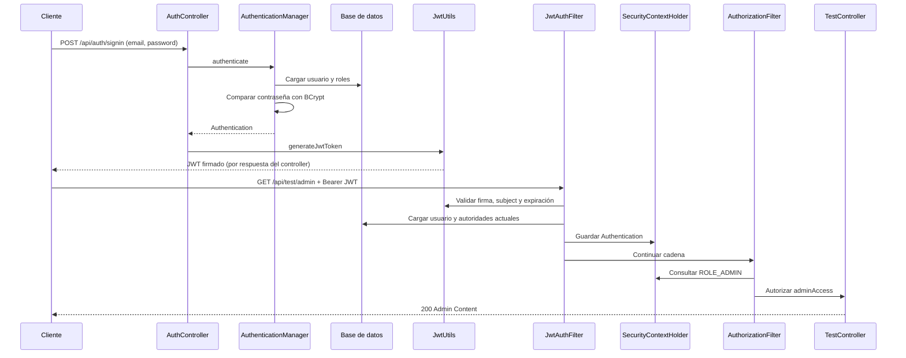

# Análisis del laboratorio 09

Las respuestas describen esta implementación y sus pruebas HTTP automatizadas.
Los casos se verificaron con H2 y con el servidor externo MariaDB 10.4.32 mediante el conector MySQL.
La validación en MySQL 8 y las capturas de Postman quedan pendientes.

## Caso 1: ruta pública

1. **¿Qué respuesta devuelve el servidor?** HTTP 200 con texto Public Content, comprobado.
2. **¿En qué archivo se encuentra?** src/main/java/com/tecsup/controller/TestController.java.
3. **¿Qué método la genera?** allAccess(), asociado a GET /api/test/all.
4. **¿Por qué no requiere autenticación?** La política permite cualquier solicitante, incluso anónimo.
5. **¿Dónde se define como pública?** En SecurityConfig.filterChain(), con
   requestMatchers("/api/auth/**", "/api/test/all").permitAll().
   La guía omite /all en su ejemplo de configuración; se añadió para satisfacer este caso.
6. **¿Qué ocurriría si eliminamos permitAll()?** Si se reemplaza esta autorización por authenticated(),
   o se elimina la regla completa para que la ruta caiga en anyRequest().authenticated(), se exigiría
   autenticación y una petición anónima devolvería 401. Borrar solo la llamada permitAll() dejando
   un matcher sin decisión puede impedir construir correctamente la configuración; no es una política válida alternativa.
7. **¿Qué rol cumple SecurityFilterChain?** Define los filtros y las reglas que evalúan la petición antes del controller;
   para /all la decisión permite continuar sin un usuario autenticado.

## Caso 2: acceso sin token

1. **¿Qué respuesta devuelve la API?** Cuerpo JSON {"message":"No autorizado"}, comprobado.
2. **¿Qué código HTTP retorna?** 401. Este proyecto fija explícitamente AuthenticationEntryPoint;
   el código de la guía, sin esa configuración, puede responder 403 según los valores predeterminados.
3. **¿Qué clase intercepta antes del controller?** FilterChainProxy aplica la cadena de seguridad.
   JwtAuthFilter examina Authorization; AuthorizationFilter aplica la regla de acceso.
4. **¿Por qué no puede acceder?** No hay credenciales JWT que acrediten un usuario con USER o ADMIN.
5. **¿Se ejecuta el método del controller?** No: la cadena rechaza la petición antes de despacharla a userAccess().
6. **¿Qué filtro participa?** JwtAuthFilter busca el token; AnonymousAuthenticationFilter aporta identidad anónima
   cuando corresponde; AuthorizationFilter deniega y ExceptionTranslationFilter encamina la respuesta al entry point.
7. **¿Qué condición provoca el rechazo?** La petición anónima no satisface hasAnyRole("USER", "ADMIN").

## Caso 3: token inválido

1. **¿Qué respuesta devuelve?** HTTP 401 para /api/test/user. Se comprobó alterando la firma de un token real.
2. **¿Qué método valida el token?** JwtUtils.validateJwtToken(), utilizando parseClaimsJws().
3. **¿En qué clase se encuentra?** com.tecsup.jwt.JwtUtils.
4. **¿Qué librería JWT utiliza?** Este proyecto incorpora JJWT de io.jsonwebtoken, versión 0.11.5,
   con jjwt-api, jjwt-impl y jjwt-jackson. Spring Boot no elige automáticamente esta biblioteca.
5. **¿Qué excepción ocurre?** Una firma alterada produce normalmente io.jsonwebtoken.security.SignatureException.
   Un formato incorrecto puede producir MalformedJwtException; un token expirado, ExpiredJwtException.
   Son variantes de JwtException y validateJwtToken las captura para devolver false.
6. **¿Qué diferencia hay entre inexistente e inválido?** Sin token no existe una credencial que verificar.
   Con token inválido sí se recibe una cadena, pero no acredita autenticidad, integridad o vigencia.
   Ambos dejan esta petición protegida sin autenticación aceptada y terminan en 401.
7. **¿Qué ocurre en JwtAuthFilter?** No crea Authentication cuando la validación devuelve false.
   Si la extracción posterior o búsqueda de usuario falla con una excepción prevista, limpia el contexto.
   Continúa la cadena, que rechaza la ruta protegida. No registra ni devuelve el token.

## Caso 4: token válido

1. **¿Qué respuesta devuelve?** HTTP 200 y User Content, comprobado con JWT de USER.
2. **¿Qué método se ejecuta?** TestController.userAccess().
3. **¿Qué función cumple JwtAuthFilter?** Extrae el Bearer token, valida el JWT, obtiene el email,
   carga al usuario y sus autoridades, y establece una autenticación para esta petición.
4. **¿Cómo obtiene Spring Security el usuario?** UserDetailsServiceImpl.loadUserByUsername(email)
   consulta UserRepository.findByEmail(); UserDetailsImpl representa el resultado.
5. **¿Qué objeto contiene la autenticación?** UsernamePasswordAuthenticationToken, guardado como Authentication
   en el SecurityContext obtenido mediante SecurityContextHolder.
6. **Flujo completo:** Postman o cliente HTTP envía Authorization: Bearer JWT → JwtAuthFilter extrae la cadena →
   JwtUtils verifica firma HS256 y expiración → UserDetailsServiceImpl carga usuario y roles →
   SecurityContextHolder recibe Authentication → AuthorizationFilter comprueba USER/ADMIN →
   TestController.userAccess() responde. Las contraseñas no se envían de nuevo en este GET.
7. **¿Qué ocurre si expiró?** parseClaimsJws detecta ExpiredJwtException; validateJwtToken devuelve false
   y la ruta protegida responde 401. Se comprobó con un token firmado cuya expiración estaba en el pasado.

## Caso 5: ADMIN sin permisos

1. **¿Qué respuesta devuelve?** JSON {"message":"Acceso denegado"}, comprobado con token USER válido.
2. **¿Qué código HTTP?** 403: la identidad fue autenticada, pero no tiene la autoridad requerida.
3. **¿En qué archivo se valida ADMIN?** SecurityConfig.java.
4. **¿Qué método y regla protegen la ruta?** filterChain() establece
   requestMatchers("/api/test/admin").hasRole("ADMIN"). hasRole agrega el prefijo ROLE_.
5. **¿Cómo obtiene los roles?** Al cargar el usuario desde la base, UserDetailsImpl.build() transforma cada Role
   en SimpleGrantedAuthority("ROLE_" + nombre en mayúsculas). Los roles se consultan en cada petición JWT;
   no se confía en una lista de roles enviada por el cliente.
6. **¿Qué estructura contiene los roles?** User tiene Set<Role>. UserDetails y Authentication exponen
   Collection de GrantedAuthority, con valores como ROLE_USER y ROLE_ADMIN.
7. **¿Authentication frente a Authorization?** Autenticación comprueba quién es el solicitante;
   autorización decide si esa identidad puede ejecutar una operación. Un JWT válido supera la primera,
   pero no concede todos los permisos.
8. **¿Por qué USER no puede ingresar?** Su Authentication carece de ROLE_ADMIN.
   AuthorizationFilter deniega, el AccessDeniedHandler devuelve 403 y adminAccess() no se ejecuta.

## Caso 6: ADMIN autorizado

1. **¿Qué respuesta devuelve?** HTTP 200 y Admin Content, comprobado.
2. **¿Qué método se ejecuta?** TestController.adminAccess().
3. **¿Qué validaciones superó?** En login, usuario existente y contraseña coincidente con BCrypt.
   En el GET, Bearer token firmado, firma correcta, expiración vigente, subject válido, usuario existente
   y presencia de ROLE_ADMIN entre sus autoridades.
4. **¿Qué rol tenía?** ADMIN en la base, representado como ROLE_ADMIN en Spring Security.
5. **¿Qué ocurre en SecurityContextHolder?** Se establece el contexto autenticado de la petición para que
   la autorización y el controller puedan consultar al principal. La cadena limpia el contexto al finalizar;
   SessionCreationPolicy.STATELESS evita mantenerlo como sesión HTTP entre peticiones.
6. **Flujo completo:**

7. **¿Qué clase genera el JWT?** JwtUtils, mediante generateJwtToken(Authentication).
   El JWT contiene el email como subject, issued-at y expiration; está firmado, no cifra sus claims.

## Cinco observaciones

1. **Comprobada:** la regla pública de /api/test/all faltaba en el SecurityConfig de la guía.
   Se agregó permitAll() y ambas suites obtuvieron 200 sin token.
2. **Comprobada:** el registro depende de roles persistidos que la guía no inicializa.
   RoleInitializer los asegura sin duplicar nombres ni eliminar datos.
3. **Comprobada:** el entorno usa MariaDB 10.4.32, aunque se lo describió inicialmente como MySQL.
   Las pruebas vía MySQL Connector/J pasan; Hibernate emite una advertencia por su detección de versión.
   **Pendiente:** validar en MySQL 8 real.
4. **Comprobada:** BCrypt guarda hashes distintos de la contraseña y permite verificar la coincidencia.
   El secreto JWT se genera para el proceso y no se versiona; cambiarlo invalida tokens anteriores.
5. **Comprobada:** las 36 pruebas HTTP separan 401 por ausencia/invalidez de credenciales de 403 por falta de rol.
   **Pendiente:** ejecutar la colección de Postman y capturar evidencia visual en esa herramienta.

## Cinco conclusiones

1. **Sustentada por las pruebas:** el flujo registro → login → JWT → endpoint protegido funciona en H2
   y en el servidor local compatible. No se extiende esta conclusión a un servidor MySQL 8 todavía no probado.
2. **Sustentada por las pruebas:** autenticar un token y autorizar un rol son decisiones diferentes.
   Un usuario USER autenticado recibe 403 en ADMIN y 200 en USER, mientras ADMIN supera ambas rutas.
3. **Sustentada por implementación y pruebas:** combinar BCrypt, firma HS256, expiración y contexto sin sesiones
   resuelve los objetivos del laboratorio. No representa por sí solo una evaluación integral de seguridad.
4. **Conclusión crítica de la guía:** permitir elegir ADMIN en un registro público sirve para reproducir
   las prácticas, pero concede privilegios a cualquier visitante. Un sistema productivo debe controlar esa asignación.
5. **Sustentada por la verificación y sus límites:** los tests reproducibles permiten comprobar los seis casos
   sin depender de capturas. La entrega debe distinguir esos resultados de Postman y MySQL 8, aún pendientes,
   y conservar la advertencia del motor para que no se confunda una prueba aprobada con soporte completo.
